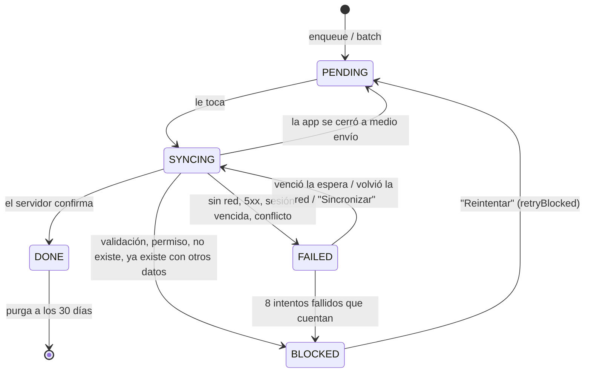

# core/sync — outbox

Escrituras que se guardan primero en el equipo (IndexedDB) y se mandan al
servidor en segundo plano: **en orden, con reintentos, y sin perder nada** si se
va la red o se cierra la app. Viene de `test-209` (donde reemplazó a Amplify
DataStore), separado de AppSync para funcionar con cualquier API.

**La regla que manda sobre todo: un registro que no llegó al servidor no se
borra nunca.** Puede quedarse reintentando o bloqueado esperando atención, pero
sigue en la cola hasta que el servidor confirme.

Demo viva: `/showcase` → pestaña *Outbox*.

## ¿Lo necesito?

Úsalo cuando la app debe **seguir capturando sin conexión** (punto de venta,
levantamiento en campo, kiosco). Si siempre hay red, no lo actives: un service
que llama a la API directo es más simple. Está apagado mientras
`SYNC_ENTITIES` esté vacío (no abre IndexedDB ni corre el motor).

Para quitarlo del todo: borra `core/sync/`, `providers/OutboxBootstrap.tsx` (y
su línea en `Providers.tsx`), `hooks/useOutboxSync.ts`,
`components/feedback/OutboxStatusPanel.tsx`, la sección del showcase y
`pnpm remove dexie fake-indexeddb`.

## Activarlo

1. **Registra la entidad** en `registry.ts`:

   ```ts
   export const SYNC_ENTITIES = {
     Order: defineEntity<CreateOrderDto, UpdateOrderDto>({
       endpoint: "/api/orders",
       versionField: "version",              // opcional, ver "Versiones"
       local: { indexes: ["customerId"] },   // opcional, ver "Tabla local"
     }),
   } satisfies SyncEntityRegistry;
   ```

2. **Encola desde el `repositories/` del feature** (nunca desde un componente):

   ```ts
   import { outbox } from "@/core/sync";

   export const orderRepository = {
     create: (dto: CreateOrderDto) => outbox.create("Order", dto),
     setStatus: (id: string, status: OrderStatus) => outbox.update("Order", { id, status }), // solo lo que cambió
     remove: (id: string) => outbox.delete("Order", id),
   };
   ```

   La promesa resuelve cuando la operación **ya está en disco**, no cuando llegó
   al servidor. Para operaciones que deben quedar juntas, `outbox.batch`
   (todo o nada) con `dependsOn` para el orden entre entidades:

   ```ts
   await outbox.batch((tx) => {
     const orderId = tx.create("Order", order);
     items.forEach((item) => tx.create("OrderItem", { ...item, orderId }));
     tx.create("Payment", { ...payment, orderId }, {
       dependsOn: [{ entityName: "Order", entityId: orderId }],
     });
   });
   ```

3. **Muestra el estado** donde tenga sentido (un menú de "Sincronización", el
   pie del layout): `<OutboxStatusPanel />` o `useOutboxSync()` para algo propio.

## Lo que tu API debe cumplir

El gateway REST (`rest-gateway.ts`) usa estas rutas por entidad:

| Operación | Petición | Respuesta |
|---|---|---|
| CREATE | `POST {endpoint}` con el cuerpo **incluyendo `id`** | el registro (o 204) |
| UPDATE | `PATCH {endpoint}/{id}` (o `PUT`) | el registro (o 204) |
| DELETE | `DELETE {endpoint}/{id}` (`?version=` si hay versión) | cualquiera |
| leer | `GET {endpoint}/{id}` | el registro, o **404** si no existe |

Y tres reglas que hacen que reenviar sea seguro:

1. **Aceptar el `id` que genera el cliente.** Si la respuesta de un CREATE se
   pierde, el motor reenvía con el mismo id; la API debe responder **409** si ya
   existe (no crear otro). El motor entonces lee el registro y lo confirma si
   tiene los datos que se mandaron.
2. **Errores con el status correcto** (`core/http/server` ya lo hace con
   `AppError`): 409 conflicto, 422 validación, 401/403 sesión/permiso, 404 no
   existe, 5xx falla del servidor. El motor decide por el status: 5xx y sin red
   se reintentan; 422/403/404 se bloquean para revisión.
3. Si la API no es REST así (GraphQL, Firebase, un SDK), escribe otro
   `RemoteGateway` (ver `gateway.ts`) y pásalo a `createSyncRuntime`.

## Versiones (concurrencia optimista)

Con `versionField`, antes de un UPDATE/DELETE el motor lee la versión actual y
la manda; si alguien más cambió el registro, la API responde 409 y el motor
reintenta con la versión nueva. Sin `versionField` el UPDATE va directo (gana el
último que escribe) y un DELETE que recibe 404 se da por cumplido.

## Tabla local (leer sin red)

Con `local: { indexes }`, cada operación también actualiza una copia en
IndexedDB **en la misma transacción** que la cola. Las pantallas leen de ahí con
`getLocalStore()` (`get`, `listAll`, `listWhereAnyOf`, `listBetween`), y las
respuestas o descargas del servidor (`applyRemote`) nunca pisan campos con
cambios locales pendientes ni registros más nuevos.

**Al agregar o quitar una tabla local en una app ya desplegada, sube
`SYNC_SCHEMA_VERSION`** (IndexedDB solo cambia de esquema con una versión nueva).

## Estados de una entrada



- **Orden:** lo de una misma entidad sale en orden y espera a lo anterior; una
  entrada con `dependsOn` espera a que su dependencia se confirme.
- **Fusión:** un UPDATE sobre un CREATE/UPDATE que aún no se intentó mandar se
  fusiona en la misma entrada.
- **Usuario:** cada entrada guarda quién la encoló y solo sale con su sesión; otro
  usuario puede adoptarla desde el panel ("Enviar con mi sesión").
- **Pestañas:** un solo envío a la vez aunque la app esté abierta en varias
  (Web Locks).

## Archivos

| Archivo | Qué es |
|---|---|
| `registry.ts` | **Lo que editas:** entidades, versión de esquema, nombre de la base |
| `index.ts` | `outbox`, `getOutbox`, `getLocalStore`, `startOutbox` de la app |
| `runtime.ts` | `createSyncRuntime`: arma motor + store + gateway para un registro |
| `outbox-engine.ts` | El ciclo de envío, reintentos y confirmaciones |
| `queue-rules.ts` | Reglas puras: fusionar, cuándo sale una entrada, backoff |
| `rest-gateway.ts` / `gateway.ts` | Cómo se habla con el servidor |
| `dexie-outbox-store.ts` / `local-store.ts` | Persistencia en IndexedDB |
| `classify-error.ts` / `messages.ts` | Error → decisión del motor / mensaje seguro |
| `__tests__/` | 120+ tests: motor, contrato del store (memoria vs. IndexedDB real), tabla local, gateway |

En desarrollo, la consola explica cada paso: filtra por `[sync·`.
